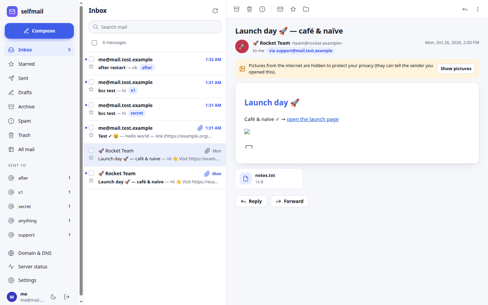
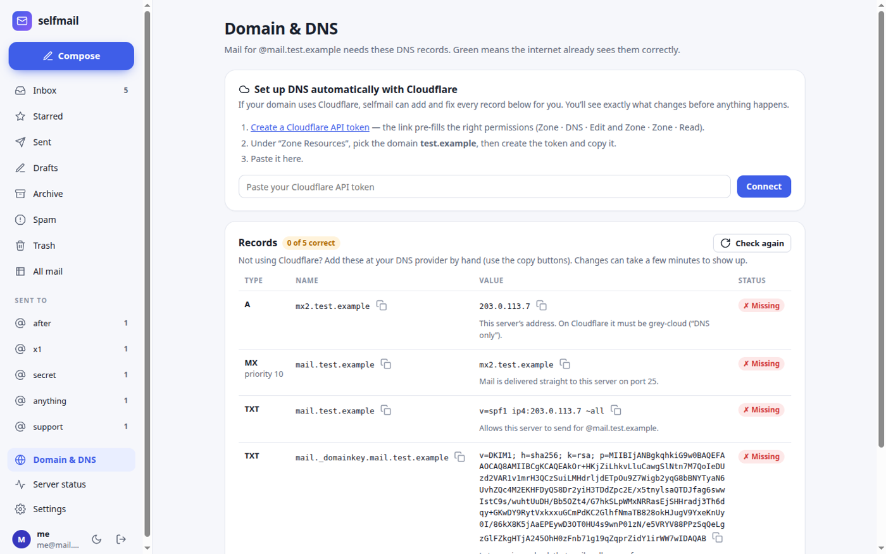

# selfmail

**Your own mail server with a modern web mail app — built for home servers and Raspberry Pis that can’t open port 25.**



One script installs Postfix, OpenDKIM and the web app. Then everything else happens in the browser: reading and writing mail, setting up DNS (automatically, if your domain is on Cloudflare), and checking that the server is healthy.

```bash
git clone https://github.com/alexd-aero/selfmail.git
cd selfmail
sudo ./setup.sh
```

## What you get

**A real mail client**
- Inbox, Starred, Sent, Drafts, Archive, Spam and Trash; read/unread, stars, bulk actions with undo
- Mail shows exactly as the sender designed it, in a locked-down frame: links open in a new tab, scripts never run, and pictures from the internet stay hidden until you allow them (they can reveal that you opened a message)
- Every language and symbol displays correctly — emoji, accents, curly quotes, Japanese, Cyrillic — whatever character set the sender used. Plain-text mail with tables or text art switches to a fixed-width font so the columns line up
- Attachments in and out, inline images, drafts that save themselves, reply / reply all / forward
- **Catch-all addresses**: anything@yourdomain arrives in your mailbox, and the sidebar groups mail by the address it was sent to — handy for giving every website its own address. You can also send *from* any of them
- New mail appears instantly (no refreshing), with optional desktop notifications
- Search with `from:`, `to:`, `subject:` and `has:attachment`; keyboard shortcuts (`j`/`k`, `c`, `r`, `e`, `#`, `/`)
- Light and dark mode; works on phones

**Setup and health, in plain language**
- **Domain & DNS** lists every record you need with copy buttons, and checks each one against public DNS
- **Connect Cloudflare** with an API token and selfmail adds or fixes all the records for you. It shows exactly what will change first, merges into an SPF record you already have instead of replacing it, keeps your own DMARC policy, and never touches unrelated records. Optionally it keeps the records updated when your home IP changes
- **Server status**: Postfix, OpenDKIM, the incoming-mail path, public IP, reverse DNS, outgoing port 25, disk space, the outgoing queue (retry or delete), the mail log, and **blocklists** — including Spamhaus, queried the way that actually works (Spamhaus refuses public DNS resolvers, which is why most checkers show it as clean)
- **Sending through a relay** (Brevo, SMTP2GO, Mailgun, Amazon SES…) with one form, for when your home IP is distrusted or port 25 is blocked



## How mail gets in without port 25

MX records carry no port number, so every mail server in the world delivers to port 25 — which most home connections can’t receive on. selfmail has two modes:

| Mode | How incoming mail arrives | Needs port 25 open? |
|---|---|---|
| **relay** (default) | [Forward Email](https://forwardemail.net) (free) receives on its port 25 and posts each message to this server over HTTPS | No |
| **direct** | This server receives on port 25 itself | Yes |

In relay mode the installer can create a **Cloudflare Tunnel** so the relay can reach your machine without any port forwarding. Only the mail drop-off path (`/inbound/…`) is reachable through it — the web mail is never exposed on the tunnel, and the app itself refuses every other path on that host name too.

## Install

Requirements: a Linux machine with systemd (Debian, Ubuntu, Raspberry Pi OS, Fedora, RHEL…), root access, and a domain you can edit DNS for. Node.js is downloaded automatically if your system doesn’t have version 18 or newer.

`sudo ./setup.sh` asks for your mail domain, mailbox name, inbound mode and a password, then:

- configures Postfix for your domain with a catch-all into one mailbox, and OpenDKIM with a new 2048-bit key
- creates Maildir storage owned by the `vmail` user (`/var/mail/vhosts`)
- installs the app in `/opt/selfmail` and runs it as `vmail` under systemd
- optionally creates the Cloudflare Tunnel and a watchdog that restarts it if it ever hangs
- prints the address to open — then go to **Domain & DNS**

Non-interactive install (for scripts):

```bash
sudo ./setup.sh --yes --domain mail.example.com --host mx.example.com --mailbox me \
     --mode relay --tunnel-host mailhook.example.com --user me --password 'a long password'
```

Already have Postfix and OpenDKIM set up by hand? `sudo ./setup.sh --adopt` installs only the app and reads your existing settings.

## Everyday commands

```bash
selfmail status            # what's running and where to open the web mail
selfmail logs -f           # the app's log
sudo selfmail passwd me    # set or reset a web login
sudo selfmail update       # install the newest version (keeps settings and mail)
sudo selfmail doctor       # find and fix common Postfix / OpenDKIM problems
sudo selfmail uninstall    # remove the app (asks before touching your mail)
```

## Updating from version 1

`sudo ./setup.sh --update` (or `sudo selfmail update`) moves a 1.x install over: your mail, DKIM key, settings and webhook secret are kept. Version 1 stored logins as plain SHA-256 hashes and shipped a published default login; both are retired, so you’ll set a new password during the update. The broad `sudo` rule from version 1 is replaced (see below).

## Security

- **Logins** use scrypt-hashed passwords and HttpOnly, SameSite=Strict session cookies. Repeated wrong passwords from one address are blocked for 15 minutes. There is no default account.
- **Every state-changing request** must carry a custom header that browsers won’t send cross-site, so other websites can’t act on your behalf.
- **The web mail listens only on this machine and your private networks** (LAN, Tailscale…), never on a public IPv6 address. To use it away from home, put it behind a VPN or an authenticating proxy.
- **Mail is shown in a sandboxed frame** with its own Content-Security-Policy: no scripts, no forms, no remote content until you allow it, and dangerous markup is stripped as a second layer.
- **The app runs as `vmail`**, not root. It can run exactly one program as root — `bin/selfmail-root` — which accepts a short list of operations (read the mail log, manage the queue, set the relay, restart Postfix/OpenDKIM/the tunnel) and validates every argument.
- **The incoming webhook** is authorised by a secret in its URL. That URL appears in a public TXT record, so anyone who reads your DNS could post junk into your inbox (never read or send). If that matters, set a webhook signing key from your Forward Email account in the config (`webhookKey`) and selfmail will verify each delivery’s signature. You can also generate a new secret address in **Settings → Receiving** at any time.

## Deliverability, honestly

SPF, DKIM and DMARC are easy and selfmail sets them up. What a home connection can’t fix:

- **Spamhaus PBL** lists home IP ranges. It’s not a penalty, but Microsoft (Outlook, Hotmail, Live) refuses mail from PBL addresses. You can remove your own IP for free at <https://check.spamhaus.org/> — the Status page shows whether you’re on it.
- **Reverse DNS** for a home IP belongs to your ISP and won’t point back to your mail host, which costs some spam score at Gmail.
- **CSS / XBL listings** mean spam or proxy traffic came from your IP (often a proxy/“bandwidth sharing” app or malware on the same network). Remove the cause before asking for removal.

The reliable fix for all three is **sending through a relay** (Settings → Sending): your mail leaves from the relay’s trusted servers while you still receive at home. Free tiers (Brevo, SMTP2GO) are plenty for personal mail.

## Troubleshooting

`sudo selfmail doctor` fixes most problems on its own: another program holding port 25, a Postfix that expects IPv6 on a machine without it, OpenDKIM socket permissions, and a stuck OpenDKIM that makes sending hang (“Greeting never received”). For anything else:

```bash
selfmail status
journalctl -u selfmail -n 50
journalctl -u postfix -u opendkim -n 50      # or /var/log/mail.log
```

## Development

The app is plain Node.js with two dependencies (`mailparser`, `nodemailer`) and a vanilla-JS front end — no build step.

```
app/server.js        HTTP routes, sessions, webhook
app/lib/             config, auth, maildir, index (store), mime, send, dns, cloudflare, status, events
app/public/          index.html, app.css, app.js
bin/selfmail         CLI            bin/selfmail-root   the root helper
setup.sh  doctor.sh  uninstall.sh
```

Run it against a test config: `SELFMAIL_ETC=/tmp/sm/etc SELFMAIL_VAR=/tmp/sm/var NODE_ENV=development node app/server.js`.

## License

MIT
